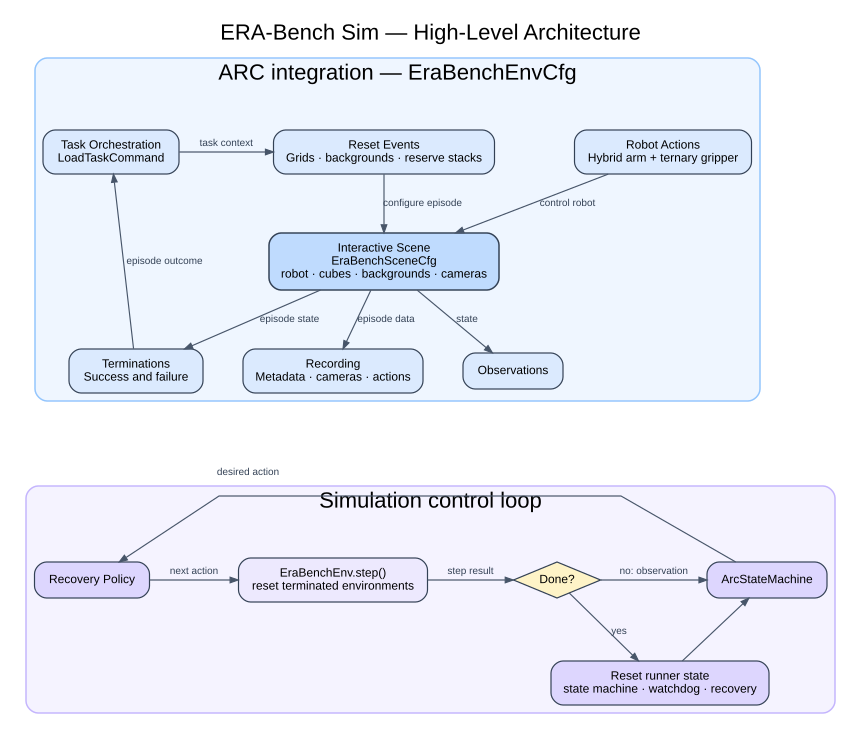

# ARC Embodied Architecture

## Scope

This analysis covers only the `tasks/manager_based/arc_embodied` task and the
supporting components it directly uses: the ARC runner, `arc_utils`, common
recording/dataset utilities, and cuRobo. The `mirror` and generic `era_bench`
task implementations are intentionally excluded.

Isaac Lab's manager-based architecture is treated as the existing host
framework. This document does not explain that architecture; it identifies the
ARC-specific additions and where they integrate with it.

## Architectural understanding

### Contribution boundary

| ARC addition | Responsibility | Isaac Lab integration |
|---|---|---|
| `EraBenchEnvCfg` | Composes the complete ARC task configuration | Supplies the custom scene and manager terms to the existing manager-based environment |
| `EraBenchEnv` | Holds ARC runtime target/reserve buffers and restores recorded progress | Extends the existing mimic-capable manager-based environment |
| `LoadTaskCommand` | Owns task assignment, pair progression, retries, and resume state | Installed as the ARC command term |
| ARC reset events | Prepare the active command and configure the task grid and reserve stacks | Installed as reset-mode event terms |
| `EraBenchSceneCfg` | Defines the Franka workspace, pooled cubes, cameras, colors, and semantics | Supplies the interactive scene configuration |
| `HybridArmAction` | Selects DiffIK or cuRobo execution for each environment | Installed as the custom arm action term |
| ARC observations and terminations | Derive ARC feedback and classify successful or failed episodes | Installed as observation and termination terms |
| ARC recorder terms | Capture task metadata, high-level actions, cameras, and video | Installed in the recorder manager configuration |
| `ArcStateMachine` and recovery policy | Generate and correct the high-level manipulation action | Remain runner-side and communicate with the environment through observations and actions |

### Main runtime flows

1. **Startup:** `EraBenchEnvCfg` registers the ARC scene and custom terms.
   `EraBenchEnv` then lets `LoadTaskCommand` recover successful task-pair
   coverage from the configured dataset.
2. **Reset:** `prepare_task_command()` advances or retries the task pair before
   later reset events read it. The events populate the input reference grid,
   output target buffer, reserve stack poses, colors, and semantic labels.
3. **Control step:** The runner reads the end-effector pose and asks
   `ArcStateMachine.compute()` for the next pose and gripper command. It adds
   controller/plan/attachment metadata and calls `EraBenchEnv.step()`.
4. **Robot execution:** `HybridArmAction` either applies DiffIK targets or
   replays a per-environment cuRobo joint plan.
5. **Feedback and episode transition:** After physics, observation and
   termination terms inspect scene state. Terminations update command status.
   Recorders finalize the episode before reset; reset events and command
   resampling then prepare the next attempt.

### Architectural decisions reflected here

- Task scheduling and retry ownership stays in `LoadTaskCommand`; runner-side
  logging only observes its public state.
- Scene assets and path/semantic lookup stay in `EraBenchSceneCfg`; reset events
  perform task-dependent scene writes.
- `ArcStateMachine` is controller-neutral. `HybridArmAction` owns DiffIK/cuRobo
  execution and only exposes a generic transition permission to the state
  machine.
- Reserve cube identity is physical and stable; color is reset-time state held
  in environment-major buffers.
- Recorders do not own control behavior. Camera observations move to CPU before
  episode buffering while retaining their `obs/...` dataset structure.

## Simple architecture diagram

The diagram shows the ARC additions integrated through `EraBenchEnvCfg` and the
runner-side simulation loop. Isaac Lab internals, implementation methods,
infrastructure dependencies, persistence technology, and internal buffers are
deliberately omitted.

Editable Graphviz source: [`arc_embodied_architecture.dot`](arc_embodied_architecture.dot)

Related runtime view:
[`ARC Embodied Runtime Layers`](arc_embodied_runtime_layers.md)

Related data view:
[`ARC Embodied High-Level Actions`](arc_embodied_high_level_actions.md)

Related benchmark view:
[`ARC Embodied Task Selection`](arc_embodied_task_selection.md)

Related scene view:
[`ARC Embodied Scene Setup`](arc_embodied_scene_setup.md)

Related orchestration view:
[`ARC Embodied Task Orchestration`](arc_embodied_task_orchestration.md)
