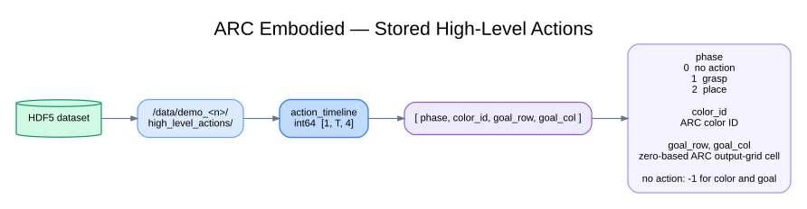

# ARC Embodied High-Level Actions

## Stored structure

Each recorded ARC episode contains one high-level action timeline:

```text
/data
└── demo_<n>
    └── high_level_actions
        └── action_timeline    int64 [1, T, 4]
```

`T` is the number of timesteps in the recorded episode. An entry is addressed
as:

```text
action_timeline[0, t] = [phase, color_id, goal_row, goal_col]
```

| Field | Stored meaning |
|---|---|
| `phase` | `0` = no action, `1` = grasp, `2` = place |
| `color_id` | Canonical ARC color ID of the selected reserve cube; `-1` when `phase` is `0` |
| `goal_row` | Zero-based output-grid row reached by the placed cube; `-1` when no placement completes |
| `goal_col` | Zero-based output-grid column reached by the placed cube; `-1` when no placement completes |

Rows and columns use the original ARC output-grid coordinate system, with `(0, 0)` at the top-left. They are derived from the observed cube pose when placement completes, not from the planned goal order.

The leading dimension is a singleton because the complete timeline is stored
once as episode-level recorder data.

## Diagram



Editable Graphviz source:
[`arc_embodied_high_level_actions.dot`](arc_embodied_high_level_actions.dot)
