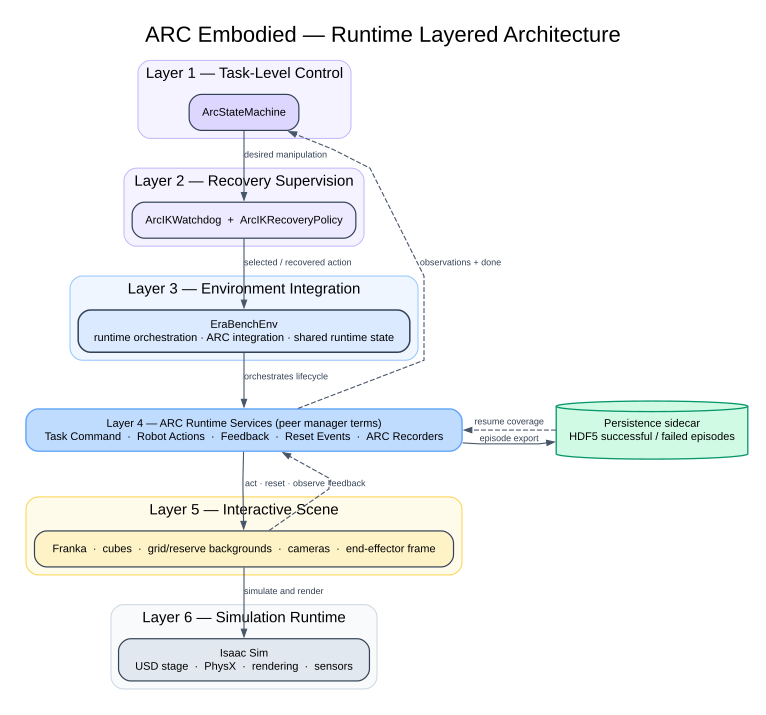

# ERA-Bench Sim Runtime Layers

## Scope

This view describes how the ARC-specific additions are arranged during a
simulation run. Isaac Lab is treated as the existing host framework; only the
custom runtime layers and their integration boundaries are shown.

## Layering rationale

| Layer | ARC responsibility |
|---|---|
| 1. Task-level control | `ArcStateMachine` selects the next manipulation state and desired robot command |
| 2. Recovery supervision | `ArcIKWatchdog` evaluates progress and `ArcIKRecoveryPolicy` may override the desired command |
| 3. Environment integration | `EraBenchEnv` connects the runner-side controllers to the manager-based runtime and owns ARC-wide runtime state |
| 4. Runtime services | `LoadTaskCommand`, action terms, observations, terminations, reset events, and recorder terms are peer services orchestrated by the environment |
| 5. Interactive scene | The instantiated scene exposes Franka, cubes, task-shaped grid/reserve backgrounds, cameras, and end-effector sensing |
| 6. Simulation runtime | Isaac Sim owns the USD stage, physics, rendering, and sensor execution |

Actions, events, observations, terminations, and recorders are intentionally
shown in one layer. Their callbacks occur at different points in the
environment lifecycle, but none is an architectural layer below another.

## Cross-layer behavior

- The main control path descends from the state machine through recovery,
  `EraBenchEnv`, the runtime services, the interactive scene, and Isaac Sim.
- Scene and task feedback returns through observations, terminations, and
  action execution status to the runner-side control layers.
- `EraBenchEnv` holds the shared ARC runtime state used by the peer services:
  task/pair progress, success targets, reserve-stack mappings, and episodic
  latches.
- Reset events use command state to repopulate the scene and runtime state at
  episode boundaries.
- HDF5 persistence is a sidecar, not a simulation layer. Recorder terms export
  episodes to it; `LoadTaskCommand` reads successful task-pair coverage from it
  during initialization.

## Simulation cadence

The configured runtime has three distinct simulation-time intervals:

| Cadence | Configuration | Effective interval | Effective frequency |
|---|---|---:|---:|
| Physics | `sim.dt = 0.01` | `0.01 s` | `100 Hz` |
| Environment/control | `decimation = 5` | `5 × 0.01 = 0.05 s` | `20 Hz` |
| Rendering | `sim.render_interval = 5` physics steps | `5 × 0.01 = 0.05 s` | `20 Hz` |

```text
simulation time:  0.00             0.05             0.10 s
physics:          P  P  P  P  P    P  P  P  P  P
control/env step: C                 C                 C
render:           R                 R                 R
```

One runner/state-machine command is processed per environment step. The action
manager then applies that command during five physics substeps before
terminations, resets, commands, and observations are evaluated again.

Camera observations and regular RTX rendering share the environment-step
cadence (`20 Hz`). `CameraObservationsRecorderTerm` records one pre-step sample
per control step and forces a fresh terminal render before reset, so the final
camera observation reflects the terminal arm and cube state.

The maximum episode duration is `320 s`, corresponding to:

- `6,400` environment/control steps;
- `32,000` physics steps; and
- `6,400` regular render intervals, plus the forced terminal render.

### Physics and rendering configuration

| Setting | Effective value |
|---|---|
| Simulation backend | Isaac Sim / PhysX on the configured simulation device |
| Gravity | `(0.0, 0.0, -9.81) m/s²` |
| PhysX bounce-threshold velocity | `0.01 m/s` |
| PhysX friction-correlation distance | `0.00625 m` |
| GPU found/lost aggregate-pair capacity | `4,194,304` |
| GPU total aggregate-pair capacity | `16,384` |
| Rendering mode | `balanced` |
| Anti-aliasing | `DLAA` |
| DL denoiser | enabled |

## Diagram



Editable Graphviz source:
[`arc_embodied_runtime_layers.dot`](arc_embodied_runtime_layers.dot)

Related data view:
[`ARC-Embodied High-Level Actions`](arc_embodied_high_level_actions.md)

Related benchmark view:
[`ERA-Bench Sim Benchmark Task Selection`](arc_embodied_task_selection.md)

Related scene view:
[`ERA-Bench Sim Scene Setup`](arc_embodied_scene_setup.md)

Related orchestration view:
[`ERA-Bench Sim Task Orchestration`](arc_embodied_task_orchestration.md)
