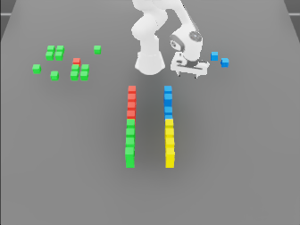
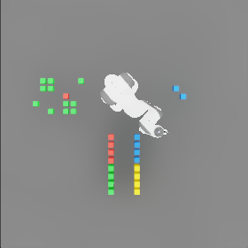

# ARC Embodied Scene Setup

## Workspace organization

The scene uses the Franka base as the local workspace origin. In the two fixed
scene-camera views, the workspace is organized as follows:

- **Left:** static ARC input-grid reference, centered at local
  `(x=0.0, y=-0.5, z=0.0) m`.
- **Middle:** Franka Panda, based at the environment origin.
- **Right:** output-grid target area, centered at local
  `(x=0.0, y=+0.5, z=0.0) m`.
- **Near/bottom:** four reserve-cube stacks in the positive-local-`x` region.

The input grid is a visual reference. The output grid is physically constructed
by moving cubes from the reserve area; output target positions are held as
runtime state rather than rendered as a second static reference grid.

## Example final frames

These are the final RGB frames from `/data/demo_50` in `era_bench.hdf5`:

- ARC task: `3b4c2228`
- Raw task-pair index: `3`
- Recorded timesteps: `291`
- Shown timestep: `290`, the last recorded frame

The pair has a `5 × 7` input grid and a `3 × 3` output grid. Its completed
output consists of two blue cubes, both visible to the right of the robot.

| Perspective camera — `table_cam` | Top-down camera — `origin_top_cam` |
|---|---|
|  |  |
| `336 × 252` RGB | `280 × 280` RGB |

## Assigned physical areas

All positions are local to one environment origin.

| Scene area | Configuration | Physical extent or capacity | Responsibility |
|---|---|---|---|
| Table | Center `(0.20, 0.00, -0.05) m` | `2.00 × 2.00 × 0.10 m`; top surface at `z=0` | Supports the complete manipulation workspace |
| Franka | Base at `(0.00, 0.00, 0.00) m` | Occupies the central workspace | Moves reserve cubes into output targets |
| Input-grid area | Anchor `(0.00, -0.50, 0.00) m` | Up to `8 × 8`; maximum grid footprint `0.46 × 0.46 m` | Displays the current ARC input as static, non-colliding cubes |
| Output-grid area | Anchor `(0.00, +0.50, 0.00) m` | Up to `8 × 8`; maximum target footprint `0.46 × 0.46 m` | Receives the constructed physical output |
| Reserve area | Four anchors at `(0.30, ±0.10)` and `(0.54, ±0.10) m` | 48 cubes total; overall envelope approximately `x=[0.28,0.74]`, `y=[-0.12,0.12]`, `z=[0,0.12] m` | Supplies four task-local cube colors to the robot |

The table spans local `x=[-0.80,1.20] m` and `y=[-1.00,1.00] m`. The grid
anchors therefore occupy opposite table halves while the reserve area remains
closest to the perspective camera.

## Cube and grid dimensions

| Property | Value |
|---|---:|
| Cube dimensions | `0.04 × 0.04 × 0.04 m` |
| Edge-to-edge separation | `0.02 m` |
| Cube-center pitch | `0.06 m` |
| Maximum `8 × 8` grid span | `0.46 × 0.46 m` |
| Reserve stacks | `4` |
| Cubes per reserve stack | `12` |
| Reserve arrangement per stack | `4` cubes across × `3` height levels |
| Reserve-cube mass | `0.08 kg` |

Input-grid cubes are kinematic, gravity-free, and have no collision geometry.
Reserve cubes—and therefore the cubes placed in the output—are dynamic,
colliding rigid bodies. The center height of a cube resting on the table is
`z=0.02 m`.

## Cameras

| Camera | Pose | Resolution | Recorded data |
|---|---|---:|---|
| `table_cam` | Fixed perspective camera at `(1.80, 0.00, 1.70) m` | `336 × 252` | RGB, image-plane depth, colorized semantic segmentation |
| `origin_top_cam` | Fixed downward camera at `(0.20, 0.00, 2.40) m` | `280 × 280` | RGB |
| `wrist_cam` | Attached to the Panda hand | `112 × 112` | RGB, image-plane depth, colorized semantic segmentation |

The scene overview uses the two fixed cameras. The wrist camera is an auxiliary
robot-centric sensor and is not part of the paired overview above.

## Layout diagram

Editable Graphviz source:
[`arc_embodied_scene_setup.dot`](arc_embodied_scene_setup.dot)
