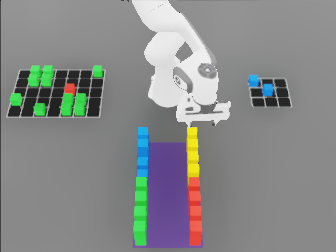
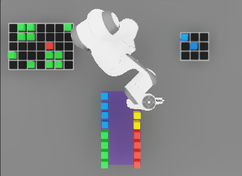
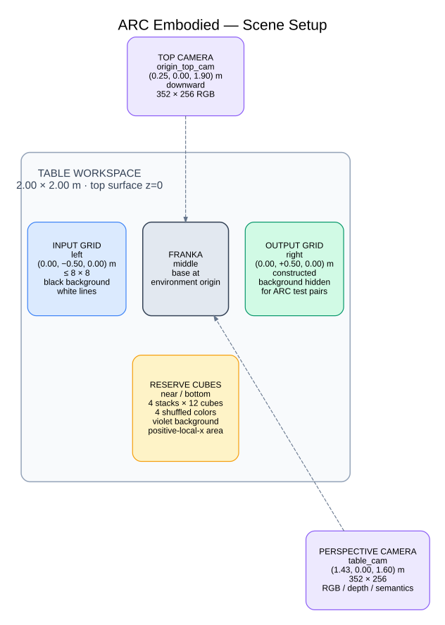

# ERA-Bench Sim Scene Setup

## Workspace organization

The scene uses the Franka base as the local workspace origin. In the two fixed
scene-camera views, the workspace is organized as follows:

- **Left:** static ARC input-grid reference, centered at local
  `(x=0.0, y=-0.5, z=0.0) m`.
- **Middle:** Franka Panda, based at the environment origin.
- **Right:** output-grid target area, centered at local
  `(x=0.0, y=+0.5, z=0.0) m`.
- **Near/bottom:** four reserve-cube stacks in the positive-local-`x` region.

The input grid is a visual reference made from static colored cubes on a dark
background with gray cell boundaries. The output grid is physically constructed
by moving cubes from the reserve area; output target positions are held as
runtime state rather than rendered as a second colored reference grid. Its
dark background and gray boundaries show the output dimensions for
demonstration pairs and are hidden for ARC test pairs—the test examples that
are distinct from a task's demonstrations.

Each reset selects a task-local palette of four reserve colors. Colors required
by the active output are included first, followed by other colors used across
the task and then fallback ARC colors. The four colors are shuffled across the
physical stack positions, so stack identity is stable but stack color is not.

## Example final frames

These are final RGB camera samples from a recorded ARC-Embodied task:

- ARC task: `3b4c2228`
- Raw task-pair index: `3`
- Recorded action/state samples: `310`
- Shown camera index: `310`, the forced terminal sample after the last control
  step

The images preserve the final recorded RGB pixels without resizing, cropping,
or color adjustment.

The pair has a `5 × 7` input grid and a `3 × 3` output grid. Its completed
output consists of two blue cubes, both visible to the right of the robot.

| Perspective camera — `table_cam` | Top-down camera — `origin_top_cam` |
|---|---|
|  |  |
| `336 × 252` RGB | `352 × 256` RGB |

## Assigned physical areas

All positions are local to one environment origin.

| Scene area | Configuration | Physical extent or capacity | Responsibility |
|---|---|---|---|
| Table | Center `(0.20, 0.00, -0.05) m` | `2.00 × 2.00 × 0.10 m`; top surface at `z=0` | Supports the complete manipulation workspace |
| Franka | Base at `(0.00, 0.00, 0.00) m` | Occupies the central workspace | Moves reserve cubes into output targets |
| Input-grid area | Anchor `(0.00, -0.50, 0.00) m` | Up to `8 × 8`; cube footprint at most `0.46 × 0.46 m`; visual background at most `0.48 × 0.48 m` | Displays the current ARC input as static, non-colliding cubes on a task-shaped dark grid with gray boundaries |
| Output-grid area | Anchor `(0.00, +0.50, 0.00) m` | Up to `8 × 8`; cube footprint at most `0.46 × 0.46 m`; visual background at most `0.48 × 0.48 m` | Receives the constructed physical output; its background is visible for demonstrations and hidden for ARC test pairs |
| Reserve area | Four anchors at `(0.30, ±0.10)` and `(0.54, ±0.10) m` | 48 cubes total; cube envelope approximately `x=[0.28,0.74]`, `y=[-0.12,0.12]`, `z=[0,0.12] m`; violet background `0.48 × 0.26 m` centered at `(0.51,0.00)` | Supplies four shuffled, task-local cube colors to the robot |

The table spans local `x=[-0.80,1.20] m` and `y=[-1.00,1.00] m`. The grid
anchors therefore occupy opposite table halves while the reserve area remains
closest to the perspective camera.

## Cube and grid dimensions

| Property | Value |
|---|---:|
| Cube dimensions | `0.04 × 0.04 × 0.04 m` |
| Edge-to-edge separation | `0.02 m` |
| Cube-center pitch | `0.06 m` |
| Maximum `8 × 8` colored-cube span | `0.46 × 0.46 m` |
| Maximum `8 × 8` visual background | `0.48 × 0.48 m` |
| Grid-boundary width | `0.005 m` |
| Visual background thickness | `0.0005 m` |
| Reserve stacks | `4` |
| Cubes per reserve stack | `12` |
| Reserve arrangement per stack | `4` cubes across × `3` height levels |
| Reserve-cube mass | `0.08 kg` |

Input-grid cubes are kinematic, gravity-free, and have no collision geometry.
Reserve cubes—and therefore the cubes placed in the output—are dynamic,
colliding rigid bodies. The center height of a cube resting on the table is
`z=0.02 m`.

The grid backgrounds, grid lines, and reserve background are visual-only assets.
Grid backgrounds are dark, boundaries are gray, and the reserve background is
deep violet (`#3A1F5C` in sRGB). Semantic cameras use color-specific cube
classes and separate classes for the table, ground, robot, grid background,
reserve background, and grid lines.

## Cameras

| Camera | Pose | Resolution | Recorded data |
|---|---|---:|---|
| `table_cam` | Fixed perspective camera at `(1.43, 0.00, 1.60) m` | `336 × 252` | RGB, image-plane depth, colorized semantic segmentation |
| `origin_top_cam` | Fixed downward camera at `(0.25, 0.00, 1.90) m` | `352 × 256` | RGB |
| `wrist_cam` | Attached to the Panda hand at local offset `(0.13, 0.00, -0.15) m` | `112 × 112` | RGB, image-plane depth, colorized semantic segmentation |

Fixed-camera poses are local to each environment origin; the wrist pose is
relative to `panda_hand`. All cameras use `update_period=0.0` and therefore
update when the simulation renders. The scene overview uses the two fixed
cameras. The wrist camera is an auxiliary robot-centric sensor and is not part
of the paired overview above.

The `table_cam` uses a `336 × 252` frame with a horizontal aperture of
`18.43` and an effective focal length of about `455.8 px`.

The `origin_top_cam` uses a patch-aligned wide frame with both dimensions
multiples of 32. Its framing prioritizes complete input and output grids; the
gripper may be partially outside this overview in extreme poses. Fine
manipulation remains available through `table_cam` and `wrist_cam`.

## Layout diagram

Editable Graphviz source:
[`arc_embodied_scene_setup.dot`](arc_embodied_scene_setup.dot)
