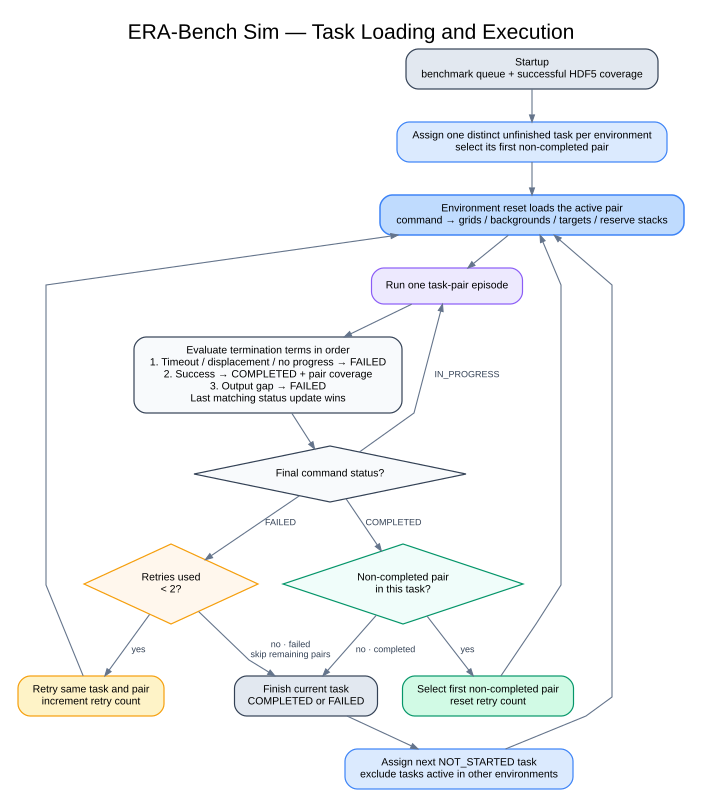

# ARC Embodied Task Orchestration

## Responsibility

`LoadTaskCommand` owns benchmark execution state. For every simulated
environment it tracks:

- one active ARC task ID;
- one active raw task-pair index;
- successful pair coverage;
- the retry count for the active pair; and
- task status: `NOT_STARTED`, `IN_PROGRESS`, `COMPLETED`, or `FAILED`.

The same lifecycle runs independently for every environment. Active task IDs
are excluded when another environment requests work, so one task is not
assigned to multiple environments at the same time.

## Startup and resume

1. `get_era_bench_tasks()` provides the benchmark membership and the tasks are
   sorted by maximum non-background output-pixel count.
2. `LoadTaskCommandCfg.tasks_ids` may restrict that queue. By default, every
   train and test pair of each selected task is scheduled in its original raw
   order.
3. After the environment managers are constructed, `EraBenchEnv.load_managers()`
   asks `LoadTaskCommand` to read successful `(task_id, task_pair)` coverage
   from the successful HDF5 dataset.
4. A task is considered already complete only if every configured pair is
   present in that successful coverage.
5. Each environment receives a distinct unfinished task and its first missing
   pair. Its retry counter starts at zero.

Failed episodes are not loaded as successful coverage. Consequently, a task
that failed in a previous run becomes eligible again when a later run resumes.

## What triggers loading

Task loading is episode-driven, not periodically timed. The command term uses a
very large resampling interval, so normal task changes are triggered by:

- the initial environment reset; or
- an environment reset after a success, failure, or timeout termination.

Inside a terminating `env.step()`:

1. Termination terms classify the active pair and update `LoadTaskCommand`.
2. Recorders finalize and export the completed episode.
3. `_reset_idx()` applies reset events.
4. The first reset event, `prepare_task_command`, chooses the retry, next pair,
   or next task and refreshes the command tensor.
5. Later reset events rebuild the input grid, output targets, reserve-stack
   poses, and reserve colors from that refreshed command.
6. `CommandManager.reset()` runs afterward. A preparation flag prevents it from
   advancing the task a second time.
7. The runner receives the done signal and resets its state machine, watchdog,
   and recovery state for the affected environments.

This ordering is why `prepare_task_command` must be the first configured reset
event: the scene setup events must see the newly selected work.

## Pair and task transitions

The current configuration uses `retries=2`.

| Episode outcome | Retry/pair state | Next work |
|---|---|---|
| Success | Another configured pair is missing | Keep the task, select its first missing pair, reset retry count |
| Success | Every configured pair has succeeded | Mark the task `COMPLETED`, assign the next unassigned `NOT_STARTED` task |
| Failure | Fewer than two retries have been used | Keep the same task and pair, increment retry count |
| Failure | Two retries have already been used | Keep the task `FAILED`, skip its remaining pairs, assign the next unassigned `NOT_STARTED` task |

Therefore one pair can receive at most three attempts in one run:

```text
initial attempt → retry 1 → retry 2 → next failure exhausts the task
```

Although the counter is named `retries_per_task`, it is reset whenever a new
pair or task is assigned and therefore acts as the active pair's retry counter.

## Episode outcome triggers

| Termination | Outcome | Current threshold |
|---|---|---:|
| Episode timeout | Failure | `320 s` = `6,400` environment steps |
| Ungrasped reserve cube displaced | Failure | More than `0.04 m` from its reset position |
| No end-effector progress | Failure | `25` stagnant control steps after `10` warm-up steps; minimum movement `0.0005 m` |
| All output targets satisfied | Success | Matching-color cube distance at most `0.015 m`, plus end-effector clearance |
| Gap in ordered output targets | Failure | Any reached–missing–reached pattern |

### Outcome-order caveat

Termination terms are evaluated in configuration order and update
`LoadTaskCommand` as side effects. The current order is timeout, reserve
displacement, no progress, success, then output gap. If an early failure and
success become true in the same simulation step, the later success term can
overwrite the earlier `FAILED` status unless the final gap term also fails.
The diagram below represents the intended single-outcome lifecycle.

## Diagram



Editable Graphviz source:
[`arc_embodied_task_orchestration.dot`](arc_embodied_task_orchestration.dot)
