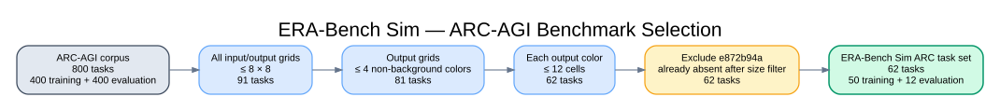

# ARC Embodied Benchmark Task Selection

## Benchmark definition

`arc_utils.get_era_bench_tasks()` defines the ARC-AGI task set used by the
benchmark. It starts with both bundled ARC-AGI splits and keeps a task only when
every training and test pair satisfies all of these constraints:

1. Every input and output grid is at most `8 × 8`.
2. Every output grid contains at most four distinct non-background colors.
3. Each non-background color (`1` through `9`) occupies at most 12 cells in
   every output grid.
4. Task `e872b94a` is explicitly excluded.

The explicit exclusion currently does not reduce the result further because
`e872b94a` has already been removed by the `8 × 8` grid constraint.

## Selection counts

| Selection stage | Total | Training | Evaluation |
|---|---:|---:|---:|
| Bundled ARC-AGI corpus | 800 | 400 | 400 |
| All grids at most `8 × 8` | 91 | 70 | 21 |
| At most four output colors | 81 | 62 | 19 |
| At most 12 output cells per color | 62 | 50 | 12 |
| Explicitly exclude `e872b94a` | **62** | **50** | **12** |

## Selected task IDs

### Training split — 50 tasks

```text
0520fde7  0d3d703e  1b2d62fb  239be575  25d8a9c8
25ff71a9  27a28665  28bf18c6  3618c87e  3aa6fb7a
3c9b0459  44f52bb0  5582e5ca  62c24649  67385a82
6d0aefbc  6e02f1e3  6fa7a44f  74dd1130  75b8110e
794b24be  7b7f7511  88a62173  8be77c9e  93b581b8
94f9d214  9565186b  99fa7670  a740d043  a79310a0
a85d4709  a9f96cdd  aedd82e4  bc1d5164  bdad9b1f
c8f0f002  c9e6f938  d037b0a7  d13f3404  d23f8c26
d4469b4b  d631b094  dae9d2b5  e9afcf9a  ed36ccf7
f2829549  f76d97a5  f9012d9b  fafffa47  ff28f65a
```

### Evaluation split — 12 tasks

```text
2072aba6  31d5ba1a  3b4c2228  4cd1b7b2
626c0bcc  66e6c45b  68b67ca3  6ea4a07e
9110e3c5  be03b35f  e133d23d  e345f17b
```

## Runtime integration

The function defines benchmark membership. `LoadTaskCommand` consumes that
result after sorting it by the maximum number of non-background output cells.
A run may narrow the set further through `LoadTaskCommandCfg.tasks_ids`, but
that does not change the 62-task benchmark definition above.

## Recorded-artifact cross-check

The task IDs in the released dataset match this 62-task selection exactly. The
artifact contains 62 task-view groups and 62 rule groups; the rule
metadata identifies the same 50 training and 12 evaluation tasks. This checks
benchmark membership, not complete pair coverage; scheduling and retry behavior
remain defined by the current simulator source rather than by one recorded run.

## Diagram



Editable Graphviz source:
[`arc_embodied_task_selection.dot`](arc_embodied_task_selection.dot)
